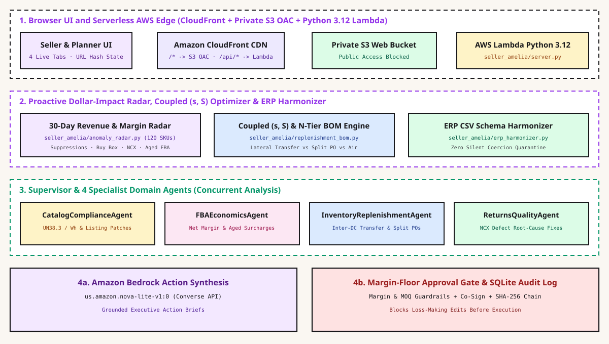

# SellerAmelia: Proactive Seller Operations and Supply Chain Multi-Agent System

- **Live CloudFront Application**: https://d33709dnlxr6aq.cloudfront.net
- **Live `/api/health` Endpoint**: https://d33709dnlxr6aq.cloudfront.net/api/health
- **GitHub Repository**: https://github.com/ritwikareddykancharla/seller-amelia-spx

SellerAmelia is a serverless application for proactive Amazon Seller Central operations and multi-echelon supply chain planning, deployed on **Amazon CloudFront + Private S3 (OAC) + AWS Lambda (serverless) + SQLite WAL + Amazon Bedrock (`us.amazon.nova-lite-v1:0`)**.



## 01 · Problem

High-velocity marketplace sellers and supply chain planners face four operational bottlenecks when managing multi-warehouse catalogs:

1. **Noisy Alert Queues**: Sorting notifications by event count buries high-dollar listing suppressions and vendor lead-time slips behind low-margin accessory warnings.
2. **Coupled Demand and Lead-Time Risk**: Safety-stock formulas that treat vendor lead times as fixed constants under-buffer during port or component slips and overlook surplus stock at sister regional distribution centers.
3. **Unguarded Repricing and Sub-MOQ Orders**: Matching competitor undercuts without deducting referral fees, FBA fulfillment fees, monthly storage, and customer return drag pushes SKUs below net-margin floors.
4. **Messy ERP and 3PL Exports**: External SAP, NetSuite, and 3PL CSV feeds mix week and day lead times, unmapped foreign currencies, negative inventory counts, and text placeholders (`TBD`).

## 02 · Architecture and Implementation

- `seller_amelia/anomaly_radar.py`: Scans a `120`-SKU catalog across four regional fulfillment centers (`ONT8-West`, `MDW2-Midwest`, `TEB9-East`, `DAL3-South`) and ranks listing suppressions, Buy Box losses, NCX customer return spikes, 181-to-365-day aged FBA surcharges, and vendor lead-time slips strictly by 30-day dollar contribution margin exposure.
- `seller_amelia/replenishment_bom.py`: Computes coupled stochastic safety stock `SS = ceil(z * sqrt(E[L]*sigma_D^2 + E[D]^2*sigma_L^2))`, traces Tier-2 and Tier-1 component delays across Bill-of-Materials (BOM) sub-assemblies to finished ASINs, and compares **Lateral DC Rebalancing Transfers** against **MOQ-Constrained Split Vendor Purchase Orders** and **Expedited Air Freight**.
- `seller_amelia/specialist_agents.py`: Coordinates a Supervisor router across `CatalogComplianceAgent`, `FBAEconomicsAgent`, `InventoryReplenishmentAgent`, and `ReturnsQualityAgent`, synthesizes action briefs via Amazon Bedrock (`us.amazon.nova-lite-v1:0`), enforces deterministic margin-floor (`MARGIN_FLOOR_BLOCKED`) and `COSIGN_REQUIRED` approval gates, and records a SHA-256 hash chain in SQLite WAL.
- `seller_amelia/erp_harmonizer.py`: Maps arbitrary ERP/3PL CSV column headers into canonical supply chain entities with unit and currency validation and zero-silent-coercion row quarantine reporting.
- `seller_amelia/server.py`: Serves `/api/health`, `/api/radar/scan`, `/api/replenish/optimize`, `/api/agents/consult`, `/api/erp/ingest`, `/api/benchmarks`, and `/api/reset` locally and via AWS Lambda Function URL behind CloudFront.

## 03 · Measured Benchmarks (`benchmarks/latest_results.json`)

Measured by `python3 benchmarks/run_benchmarks.py` in `us-west-2`:

| Metric | Measured Value | Notes |
| --- | --- | --- |
| **120-SKU Dollar-Impact Radar Scan (`p50` / `p95`)** | `0.489 ms` / `0.603 ms` | `$350,390.13` 30d margin exposure across `28` anomalies |
| **Top-10 Margin Exposure Captured** | `81.22%` vs. `6.48%` | `+74.74` pt lift vs. raw alert-count sorting |
| **Monte Carlo Stockout Day Rate (`160` trials)** | `0.40%` vs. `6.88%` | `94.2%` relative reduction (`Coupled (s, S) + Lateral` vs. `Naive`) |
| **Monte Carlo Unit Fill Rate / Portfolio Cost** | `99.59%` / `-62.5%` cost | Saves `$55,723.54` per 60-day multi-DC portfolio trial |
| **3-Way Replenishment & N-Tier BOM Trace (`p50`)** | `0.009 ms` / `0.018 ms` | Lateral DC Transfer vs. Split Vendor PO vs. Air Freight |
| **ERP CSV Harmonization (`p50` / `p95`)** | `0.062 ms` / `0.081 ms` | `3 / 3` corrupt rows quarantined (`0` silent coercions) |
| **Margin-Floor & MOQ Guardrail Block Rate** | `12 / 12` (`100.0%`) | `0.002 ms` `p50` check (tested with co-sign active) |
| **Amazon Bedrock Multi-Agent Pass Rate** | `12 / 12` (`100.0%`) | `us.amazon.nova-lite-v1:0` (`880.0 ms` `p50`, `944.2` mean tokens) |
| **SQLite WAL SHA-256 Chain Verification** | `0.207 ms` | Verified across `25` chained audit entries |

## 04 · Local Quickstart and Verification

```bash
# Run the 12-test unit suite
python3 -m unittest discover -s tests -v

# Re-run live Amazon Bedrock + Monte Carlo supply chain benchmarks
unset AWS_ACCESS_KEY_ID AWS_SECRET_ACCESS_KEY AWS_SESSION_TOKEN
export AWS_PROFILE=portfolio AWS_DEFAULT_REGION=us-west-2
python3 benchmarks/run_benchmarks.py

# Start local studio at http://localhost:3099
python3 -m seller_amelia.server
```
